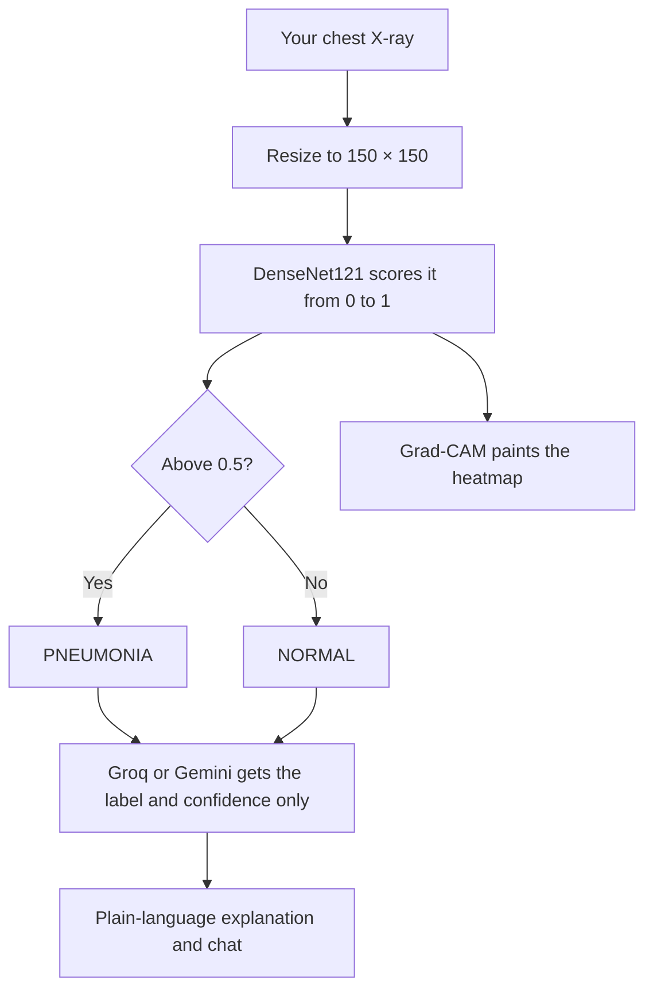
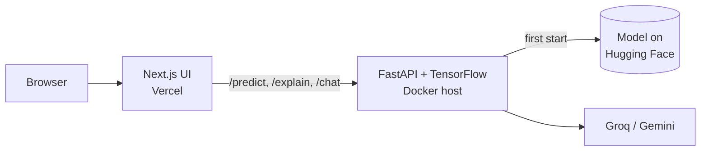

<!-- Automatically generated from README.md by .github/workflows/translate-readme.yml. Do not edit by hand. -->
<p align="center"><sub><a href="../../README.md">English</a> · <a href="README.ta.md">தமிழ்</a> · <a href="README.hi.md">हिन्दी</a> · <a href="README.te.md">తెలుగు</a> · <a href="README.ml.md">മലയാളം</a> · <a href="README.kn.md">ಕನ್ನಡ</a> · <a href="README.bn.md">বাংলা</a> · <a href="README.es.md">Español</a> · <a href="README.fr.md">Français</a> · <b>Deutsch</b> · <a href="README.pt-BR.md">Português</a> · <a href="README.ja.md">日本語</a> · <a href="README.zh-CN.md">简体中文</a> · <a href="README.ar.md">العربية</a></sub></p>

<p align="center">
  <a href="https://pneumonia-detector-machine-learning.vercel.app">
    
  </a>
</p>

<p align="center">
  <a href="https://pneumonia-detector-machine-learning.vercel.app"><b>Live-Demo</b></a>
  &nbsp;·&nbsp;
  <a href="#how-it-works">Funktionsweise</a>
  &nbsp;·&nbsp;
  <a href="#run-it-yourself">Selbst ausführen</a>
</p>

<p align="center">
  
  
  
  
  
</p>


PneumoScan ist ein Screening‑Tool für Thorax‑Röntgenaufnahmen, das mehr als nur ein Label zurückgibt. Für jedes Bild liefert es ein Urteil mit einem Vertrauenswert, eine Grad‑CAM‑Heatmap des Bereichs, der die Vorhersage beeinflusste, sowie eine verständliche Erklärung, die über einen Chat erkundet werden kann.

Die Live‑Demo enthält Beispiel‑Röntgenaufnahmen, die mit einem Klick ausgeführt werden können, und akzeptiert das Hochladen eigener Bilder.

> **PneumoScan ist eine Screening‑Demonstration, kein diagnostisches Werkzeug.** Ein qualifizierter Kliniker muss jedes Röntgenbild prüfen. Personen mit starker Atemnot oder Brustschmerzen sollten sofort medizinische Hilfe in Anspruch nehmen.

<p align="center">
  
</p>

## Features

<p align="center">
  
</p>

* **Urteil und Vertrauenswert.** Jede Röntgenaufnahme wird als NORMAL oder PNEUMONIE klassifiziert, zusammen mit dem Vertrauenswert des Modells für dieses Ergebnis.
* **Visuelle Evidenz.** Eine Grad‑CAM‑Heatmap wird neben dem Originalbild angezeigt, mit einem Vergleichs‑Slider und einer Vergrößerungslinse für genauere Inspektion.
* **Erklärung in Alltagssprache.** Ein Sprachmodell (Groq, mit Gemini als Rückfallback) erläutert, was das Ergebnis bedeutet und was nicht. Es ist angewiesen, niemals zu diagnostizieren oder Behandlungen zu empfehlen.
* **Kontextueller Chat.** Nachfragen werden im Kontext des Ergebnisses beantwortet. Unzusammenhängende Fragen werden höflich abgelehnt.
* **Teilbare Ergebnis‑Karte.** Jedes Ergebnis kann als PNG‑Bild gespeichert werden.
* **Graceful Degradation.** Die Vorhersage wird weiterhin angezeigt, wenn die Heatmap oder das Sprachmodell nicht verfügbar sind.

<a id="how-it-works"></a>

## How it works

Der Weg einer hochgeladenen Röntgenaufnahme durch das System:



Nur das vorhergesagte Label und dessen Vertrauenswert werden an das Sprachmodell gesendet. Das Bild selbst wird niemals mit ihm geteilt.

Die Architektur des bereitgestellten Systems:



Die API stellt vier Endpunkte bereit: `/health`, `/predict`, `/explain` und `/chat`. Das Trainings‑Notebook ist unter [`Notebook/`](../../Notebook) verfügbar.

<a id="run-it-yourself"></a>

## Run it yourself

```bash
git clone https://github.com/aristotile-dev/Pneumonia-Detector-Machine-Learning-Tensorflow.git
cd Pneumonia-Detector-Machine-Learning-Tensorflow
```

**Backend.** Das Modell wird beim ersten Start automatisch heruntergeladen. Setzen Sie `GROQ_API_KEY` oder `GEMINI_API_KEY`, um die Erklärung und den Chat zu aktivieren (siehe `backend/.env.example`).

```bash
cd backend
pip install -r requirements.txt
uvicorn main:app --reload
```

**Frontend**, in einem zweiten Terminal:

```bash
cd frontend
cp .env.example .env.local
npm install
npm run dev
```

Anschließend öffnen Sie http://localhost:3000.

## Deploying

Die API kann nicht als Vercel‑Funktion ausgeführt werden: ihre Abhängigkeiten umfassen etwa 1,2 GB, was über dem Vercel‑Limit von 500 MB liegt. Sie benötigt einen Docker‑Host mit mindestens 2 GB RAM. `backend/Dockerfile` lauscht auf `$PORT`.

| Backend‑Variable | Erforderlich | Beschreibung |
| :--- | :---: | :--- |
| `GROQ_API_KEY` oder `GEMINI_API_KEY` | Einer der beiden | Aktiviert die Erklärung und den Chat. Groq hat Vorrang, wenn beide gesetzt sind. |
| `ALLOWED_ORIGINS` | Ja | Die Frontend‑Origin. Mehrere Origins durch Kommas trennen. |
| `MODEL_URL`, `HF_TOKEN` | Nein | Modell von einem anderen Ort laden. |

Eine Antwort `model_loaded: true` von `/health` bestätigt, dass das Modell bereit ist.

Für das Frontend auf Vercel setzen Sie das Root‑Directory auf `frontend` und `NEXT_PUBLIC_API_URL` auf die Basis‑URL der API ohne abschließenden Schrägstrich. Der Wert wird zur Build‑Zeit eingebettet, daher nach Änderung erneut deployen.

## Technology

| Layer | Technology |
| :--- | :--- |
| Model | DenseNet121 with transfer learning, built with TensorFlow and Keras |
| Explainability | Grad-CAM heatmaps |
| Image processing | Pillow and NumPy |
| API | FastAPI served by Uvicorn |
| Interface | Next.js 15 (App Router), plain CSS and the Archivo typeface |
| Language model | Groq (`openai/gpt-oss-120b`), with Gemini (`gemini-3.5-flash-lite`) as a fallback |
| Model hosting | Hugging Face Hub |

## License

Released under the MIT License. See [LICENSE](../../LICENSE) for the full text.
