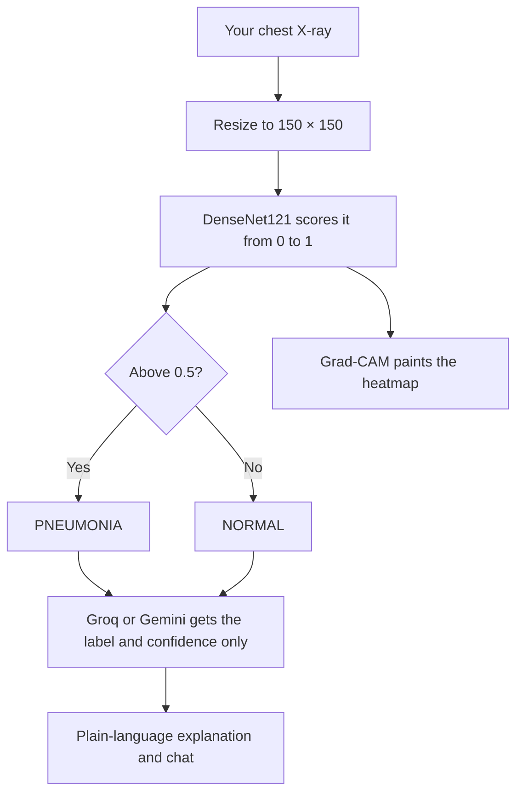
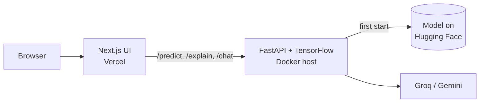

<!-- Automatically generated from README.md by .github/workflows/translate-readme.yml. Do not edit by hand. -->
<p align="center"><sub><a href="../../README.md">English</a> · <a href="README.ta.md">தமிழ்</a> · <a href="README.hi.md">हिन्दी</a> · <a href="README.te.md">తెలుగు</a> · <a href="README.ml.md">മലയാളം</a> · <a href="README.kn.md">ಕನ್ನಡ</a> · <a href="README.bn.md">বাংলা</a> · <b>Español</b> · <a href="README.fr.md">Français</a> · <a href="README.de.md">Deutsch</a> · <a href="README.pt-BR.md">Português</a> · <a href="README.ja.md">日本語</a> · <a href="README.zh-CN.md">简体中文</a> · <a href="README.ar.md">العربية</a></sub></p>

<p align="center">
  <a href="https://pneumonia-detector-machine-learning.vercel.app">
    
  </a>
</p>

<p align="center">
  <a href="https://pneumonia-detector-machine-learning.vercel.app"><b>Demo en vivo</b></a>
  &nbsp;·&nbsp;
  <a href="#how-it-works">Cómo funciona</a>
  &nbsp;·&nbsp;
  <a href="#run-it-yourself">Ejecutarlo tú mismo</a>
</p>

<p align="center">
  
  
  
  
  
</p>


PneumoScan es una herramienta de cribado mediante radiografía de tórax que devuelve más que una etiqueta. Para cada imagen informa un veredicto con una puntuación de confianza, un mapa de calor Grad‑CAM de la región que impulsó la predicción y una explicación en lenguaje sencillo que puede explorarse a través de un chat.

La demo en vivo incluye radiografías de ejemplo que pueden ejecutarse con un solo clic, y acepta la carga de tus propias imágenes.

> **PneumoScan es una demostración de cribado, no una herramienta diagnóstica.** Un clínico cualificado debe revisar cada radiografía. Cualquier persona que experimente dificultad respiratoria severa o dolor torácico debe buscar atención médica de inmediato.

<p align="center">
  
</p>

## Features

<p align="center">
  
</p>

* **Veredicto y confianza.** Cada radiografía se clasifica como NORMAL o PNEUMONIA, junto con la confianza del modelo en ese resultado.
* **Evidencia visual.** Se muestra un mapa de calor Grad‑CAM junto a la imagen original, con un control deslizante de comparación y una lente de zoom para inspección más cercana.
* **Explicación en lenguaje sencillo.** Un modelo de lenguaje (Groq, con Gemini como alternativa) explica lo que el resultado significa y lo que no significa. Se le instruye nunca diagnosticar ni recomendar tratamiento.
* **Chat contextual.** Las preguntas de seguimiento se responden en el contexto del resultado. Las preguntas no relacionadas se rechazan cortésmente.
* **Tarjeta de resultado compartible.** Cualquier resultado puede guardarse como una imagen PNG.
* **Degradación elegante.** La predicción sigue mostrándose cuando el mapa de calor o el modelo de lenguaje no están disponibles.

<a id="how-it-works"></a>

## How it works

El recorrido de una radiografía cargada a través del sistema:



Solo la etiqueta predicha y su confianza se envían al modelo de lenguaje. La imagen en sí nunca se comparte con él.

La arquitectura del sistema desplegado:



La API expone cuatro endpoints: `/health`, `/predict`, `/explain` y `/chat`. El cuaderno de entrenamiento está disponible en [`Notebook/`](../../Notebook).

<a id="run-it-yourself"></a>

## Run it yourself

```bash
git clone https://github.com/aristotile-dev/Pneumonia-Detector-Machine-Learning-Tensorflow.git
cd Pneumonia-Detector-Machine-Learning-Tensorflow
```

**Backend.** El modelo se descarga automáticamente en el primer inicio. Define `GROQ_API_KEY` o `GEMINI_API_KEY` para habilitar la explicación y el chat (ver `backend/.env.example`).

```bash
cd backend
pip install -r requirements.txt
uvicorn main:app --reload
```

**Frontend**, en una segunda terminal:

```bash
cd frontend
cp .env.example .env.local
npm install
npm run dev
```

Luego abre http://localhost:3000.

## Deploying

La API no puede ejecutarse como una función de Vercel: sus dependencias suman aproximadamente 1,2 GB, por encima del límite de 500 MB de Vercel. Requiere un host Docker con al menos 2 GB de RAM. `backend/Dockerfile` escucha en `$PORT`.

| Backend variable | Required | Description |
| :--- | :---: | :--- |
| `GROQ_API_KEY` or `GEMINI_API_KEY` | One of the two | Enables the explanation and chat. Groq takes precedence when both are set. |
| `ALLOWED_ORIGINS` | Yes | The frontend origin. Separate several origins with commas. |
| `MODEL_URL`, `HF_TOKEN` | No | Load the model from a different location. |

Una respuesta de `model_loaded: true` de `/health` confirma que el modelo está listo.

Para el frontend en Vercel, establece el Root Directory en `frontend` y define `NEXT_PUBLIC_API_URL` con la URL base de la API sin barra final. El valor se incrusta en tiempo de compilación, por lo que debes volver a desplegar después de cambiarlo.

## Technology

| Layer | Technology |
| :--- | :--- |
| Model | DenseNet121 with transfer learning, built with TensorFlow and Keras |
| Explainability | Grad-CAM heatmaps |
| Image processing | Pillow and NumPy |
| API | FastAPI served by Uvicorn |
| Interface | Next.js 15 (App Router), plain CSS and the Archivo typeface |
| Language model | Groq (`openai/gpt-oss-120b`), with Gemini (`gemini-3.5-flash-lite`) as a fallback |
| Model hosting | Hugging Face Hub |

## License

Released under the MIT License. See [LICENSE](../../LICENSE) for the full text.
