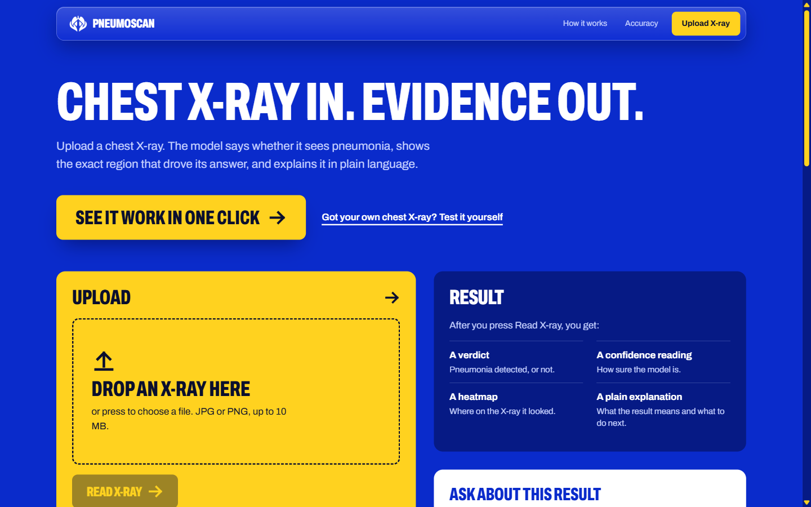
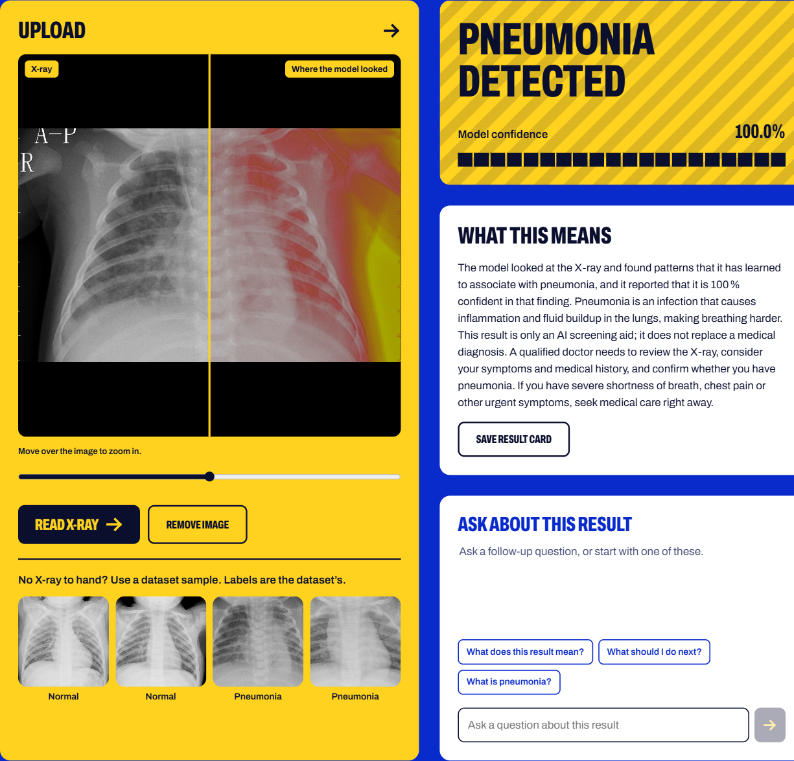
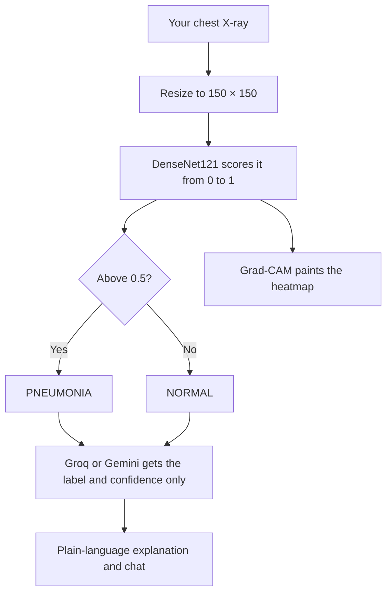
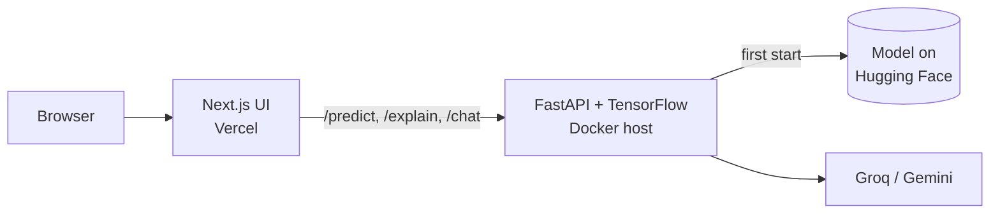

<!-- Automatically generated from README.md by .github/workflows/translate-readme.yml. Do not edit by hand. -->
<p align="center"><sub><a href="../../README.md">English</a> · <a href="README.ta.md">தமிழ்</a> · <b>हिन्दी</b> · <a href="README.te.md">తెలుగు</a> · <a href="README.ml.md">മലയാളം</a> · <a href="README.kn.md">ಕನ್ನಡ</a> · <a href="README.bn.md">বাংলা</a> · <a href="README.es.md">Español</a> · <a href="README.fr.md">Français</a> · <a href="README.de.md">Deutsch</a> · <a href="README.pt-BR.md">Português</a> · <a href="README.ja.md">日本語</a> · <a href="README.zh-CN.md">简体中文</a> · <a href="README.ar.md">العربية</a></sub></p>

<p align="center">
  <a href="https://pneumonia-detector-machine-learning.vercel.app">
    
  </a>
</p>

<p align="center">
  <a href="https://pneumonia-detector-machine-learning.vercel.app"><b>Live demo</b></a>
  &nbsp;·&nbsp;
  <a href="#how-it-works">How it works</a>
  &nbsp;·&nbsp;
  <a href="#run-it-yourself">Run it yourself</a>
</p>

<p align="center">
  
  
  
  
  
</p>


PneumoScan एक छाती की X‑ray स्क्रीनिंग टूल है जो केवल लेबल नहीं बल्कि अधिक जानकारी देता है। प्रत्येक छवि के लिए यह एक निर्णय के साथ विश्वास स्कोर, भविष्यवाणी को प्रेरित करने वाले क्षेत्र का Grad‑CAM हीटमैप, और एक साधारण भाषा में व्याख्या प्रदान करता है जिसे चैट के माध्यम से खोजा जा सकता है।

लाइव डेमो में नमूना X‑rays शामिल हैं जिन्हें एक क्लिक से चलाया जा सकता है, और यह आपके अपने चित्रों के अपलोड को भी स्वीकार करता है।

> **PneumoScan एक स्क्रीनिंग डेमोंस्ट्रेशन है, न कि निदान उपकरण।** प्रत्येक X‑ray की समीक्षा एक योग्य चिकित्सक को करनी चाहिए। जो कोई भी गंभीर श्वास कठिनाई या छाती में दर्द का अनुभव कर रहा हो, उसे तुरंत चिकित्सा सहायता लेनी चाहिए।

<p align="center">
  
</p>

## Features

<p align="center">
  
</p>

* **Verdict and confidence.** प्रत्येक X‑ray को NORMAL या PNEUMONIA के रूप में वर्गीकृत किया जाता है, साथ ही मॉडल का उस परिणाम में विश्वास स्कोर भी दिखाया जाता है।
* **Visual evidence.** मूल छवि के बगल में Grad‑CAM हीटमैप प्रदर्शित होता है, जिसमें तुलना स्लाइडर और निकट निरीक्षण के लिए ज़ूम लेंस होता है।
* **Plain-language explanation.** एक भाषा मॉडल (Groq, Gemini को फॉलबैक के रूप में) परिणाम का क्या अर्थ है और क्या नहीं है, इसे समझाता है। इसे कभी भी निदान या उपचार की सिफारिश करने के लिए नहीं कहा गया है।
* **Contextual chat.** परिणाम के संदर्भ में आगे के प्रश्नों के उत्तर दिए जाते हैं। असंबंधित प्रश्नों को शिष्टतापूर्वक अस्वीकार किया जाता है।
* **Shareable result card.** किसी भी परिणाम को PNG छवि के रूप में सहेजा जा सकता है।
* **Graceful degradation.** यदि हीटमैप या भाषा मॉडल उपलब्ध नहीं है, तब भी भविष्यवाणी प्रदर्शित की जाती है।

<a id="how-it-works"></a>

## How it works

एक अपलोड की गई X‑ray का सिस्टम में प्रवाह:



केवल भविष्यवाणी किया गया लेबल और उसका विश्वास स्कोर भाषा मॉडल को भेजा जाता है। छवि स्वयं कभी भी उसके साथ साझा नहीं की जाती।

डिप्लॉय किए गए सिस्टम की वास्तुकला:



API चार एंडपॉइंट्स उजागर करता है: `/health`, `/predict`, `/explain` और `/chat`। प्रशिक्षण नोटबुक उपलब्ध है [`Notebook/`](../../Notebook) में।

<a id="run-it-yourself"></a>

## Run it yourself

```bash
git clone https://github.com/aristotile-dev/Pneumonia-Detector-Machine-Learning-Tensorflow.git
cd Pneumonia-Detector-Machine-Learning-Tensorflow
```

**Backend.** मॉडल पहली बार शुरू होने पर स्वचालित रूप से डाउनलोड हो जाता है। व्याख्या और चैट को सक्षम करने के लिए `GROQ_API_KEY` या `GEMINI_API_KEY` सेट करें (देखें `backend/.env.example`)।

```bash
cd backend
pip install -r requirements.txt
uvicorn main:app --reload
```

**Frontend**, दूसरे टर्मिनल में:

```bash
cd frontend
cp .env.example .env.local
npm install
npm run dev
```

फिर http://localhost:3000 खोलें।

## Deploying

API को Vercel फ़ंक्शन के रूप में नहीं चलाया जा सकता: इसकी निर्भरताएँ लगभग 1.2 GB हैं, जो Vercel की 500 MB सीमा से अधिक है। इसे कम से कम 2 GB RAM वाले Docker होस्ट की आवश्यकता होती है। `backend/Dockerfile` `$PORT` पर सुनता है।

| Backend variable | Required | Description |
| :--- | :---: | :--- |
| `GROQ_API_KEY` or `GEMINI_API_KEY` | One of the two | व्याख्या और चैट को सक्षम करता है। दोनों सेट होने पर Groq को प्राथमिकता दी जाती है। |
| `ALLOWED_ORIGINS` | Yes | फ्रंटएंड का मूल। कई मूल को कॉमा से अलग करें। |
| `MODEL_URL`, `HF_TOKEN` | No | मॉडल को किसी अन्य स्थान से लोड करने के लिए। |

`/health` से `model_loaded: true` प्रतिक्रिया यह पुष्टि करती है कि मॉडल तैयार है।

Vercel पर फ्रंटएंड के लिए, Root Directory को `frontend` सेट करें और `NEXT_PUBLIC_API_URL` को API के बेस URL (बिना ट्रेलिंग स्लैश) पर सेट करें। यह मान बिल्ड समय पर एम्बेड किया जाता है, इसलिए बदलने के बाद पुनः डिप्लॉय करें।

## Technology

| Layer | Technology |
| :--- | :--- |
| Model | DenseNet121 with transfer learning, built with TensorFlow and Keras |
| Explainability | Grad-CAM heatmaps |
| Image processing | Pillow and NumPy |
| API | FastAPI served by Uvicorn |
| Interface | Next.js 15 (App Router), plain CSS and the Archivo typeface |
| Language model | Groq (`openai/gpt-oss-120b`), with Gemini (`gemini-3.5-flash-lite`) as a fallback |
| Model hosting | Hugging Face Hub |

## License

Released under the MIT License. See [LICENSE](../../LICENSE) for the full text.
