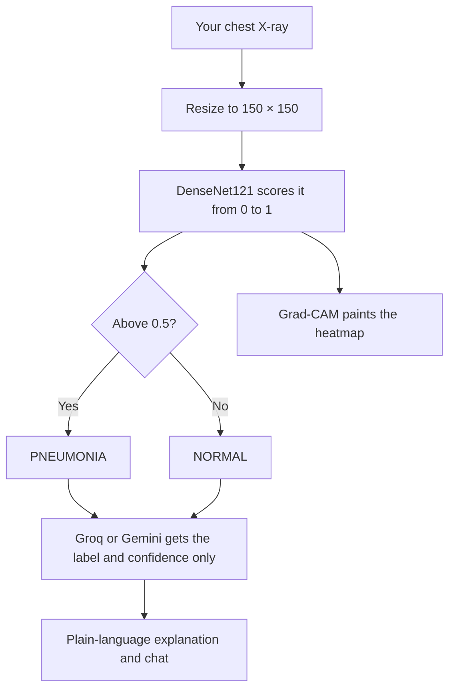
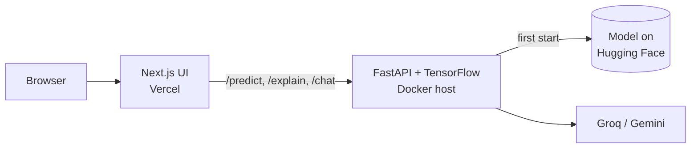

<!-- Automatically generated from README.md by .github/workflows/translate-readme.yml. Do not edit by hand. -->
<p align="center"><sub><a href="../../README.md">English</a> · <a href="README.ta.md">தமிழ்</a> · <a href="README.hi.md">हिन्दी</a> · <a href="README.te.md">తెలుగు</a> · <a href="README.ml.md">മലയാളം</a> · <a href="README.kn.md">ಕನ್ನಡ</a> · <a href="README.bn.md">বাংলা</a> · <a href="README.es.md">Español</a> · <a href="README.fr.md">Français</a> · <a href="README.de.md">Deutsch</a> · <a href="README.pt-BR.md">Português</a> · <b>日本語</b> · <a href="README.zh-CN.md">简体中文</a> · <a href="README.ar.md">العربية</a></sub></p>

<p align="center">
  <a href="https://pneumonia-detector-machine-learning.vercel.app">
    
  </a>
</p>

<p align="center">
  <a href="https://pneumonia-detector-machine-learning.vercel.app"><b>Live demo</b></a>
  &nbsp;·&nbsp;
  <a href="#how-it-works">How it works</a>
  &nbsp;·&nbsp;
  <a href="#run-it-yourself">Run it yourself</a>
</p>

<p align="center">
  
  
  
  
  
</p>


PneumoScan は胸部 X 線のスクリーニングツールで、ラベル以上の情報を返します。各画像について、判定と信頼度スコア、予測を導いた領域の Grad‑CAM ヒートマップ、そしてチャットで探索できる平易な説明を提供します。

ライブデモにはワンクリックで実行できるサンプル X 線が含まれており、独自の画像のアップロードも受け付けます。

> **PneumoScan はスクリーニングのデモであり、診断ツールではありません。** 資格を有する臨床医がすべての X 線を確認する必要があります。重度の息切れや胸痛がある場合は、直ちに医療機関を受診してください。

<p align="center">
  
</p>

## Features

<p align="center">
  
</p>

* **Verdict and confidence.** 各 X 線は NORMAL または PNEUMONIA と分類され、モデルの信頼度が併せて示されます。  
* **Visual evidence.** Grad‑CAM ヒートマップが元画像の横に表示され、比較スライダーと拡大レンズで詳細に確認できます。  
* **Plain-language explanation.** 言語モデル（Groq、フォールバックとして Gemini） が結果の意味を平易に説明します。診断や治療の推奨は行わないよう指示されています。  
* **Contextual chat.** 結果に関する追質問に対してコンテキストを踏まえて回答し、無関係な質問は丁寧に断ります。  
* **Shareable result card.** 任意の結果を PNG 画像として保存できます。  
* **Graceful degradation.** ヒートマップや言語モデルが利用できない場合でも、予測結果は表示されます。

<a id="how-it-works"></a>

## How it works

アップロードされた X 線がシステム内を通過する流れ:



言語モデルへ送信されるのは予測ラベルとその信頼度のみで、画像自体は共有されません。

デプロイされたシステムのアーキテクチャ:



API は 4 つのエンドポイントを公開しています: `/health`、`/predict`、`/explain`、`/chat`。トレーニングノートブックは [`Notebook/`](../../Notebook) にあります。

<a id="run-it-yourself"></a>

## Run it yourself

```bash
git clone https://github.com/aristotile-dev/Pneumonia-Detector-Machine-Learning-Tensorflow.git
cd Pneumonia-Detector-Machine-Learning-Tensorflow
```

**Backend.** 初回起動時にモデルが自動的にダウンロードされます。`GROQ_API_KEY` または `GEMINI_API_KEY` を設定して説明機能とチャットを有効化してください（`backend/.env.example` を参照）。

```bash
cd backend
pip install -r requirements.txt
uvicorn main:app --reload
```

**Frontend** は別のターミナルで:

```bash
cd frontend
cp .env.example .env.local
npm install
npm run dev
```

その後、http://localhost:3000 を開きます。

## Deploying

API は Vercel 関数としては実行できません。依存関係の総容量が約 1.2 GB で、Vercel の 500 MB 制限を超えるためです。少なくとも 2 GB の RAM を持つ Docker ホストが必要です。`backend/Dockerfile` は `$PORT` で待ち受けます。

| Backend variable | Required | Description |
| :--- | :---: | :--- |
| `GROQ_API_KEY` or `GEMINI_API_KEY` | One of the two | 説明機能とチャットを有効化します。両方設定されている場合は Groq が優先されます。 |
| `ALLOWED_ORIGINS` | Yes | フロントエンドのオリジン。複数指定する場合はカンマで区切ります。 |
| `MODEL_URL`, `HF_TOKEN` | No | 別の場所からモデルをロードする際に使用します。 |

`/health` のレスポンスに `model_loaded: true` が含まれていれば、モデルは準備完了です。

Vercel 上のフロントエンドでは、Root Directory を `frontend` に設定し、`NEXT_PUBLIC_API_URL` を API のベース URL（末尾のスラッシュなし）に設定してください。値はビルド時に埋め込まれるため、変更後は再デプロイが必要です。

## Technology

| Layer | Technology |
| :--- | :--- |
| Model | DenseNet121 with transfer learning, built with TensorFlow and Keras |
| Explainability | Grad-CAM heatmaps |
| Image processing | Pillow and NumPy |
| API | FastAPI served by Uvicorn |
| Interface | Next.js 15 (App Router), plain CSS and the Archivo typeface |
| Language model | Groq (`openai/gpt-oss-120b`), with Gemini (`gemini-3.5-flash-lite`) as a fallback |
| Model hosting | Hugging Face Hub |

## License

Released under the MIT License. See [LICENSE](../../LICENSE) for the full text.
