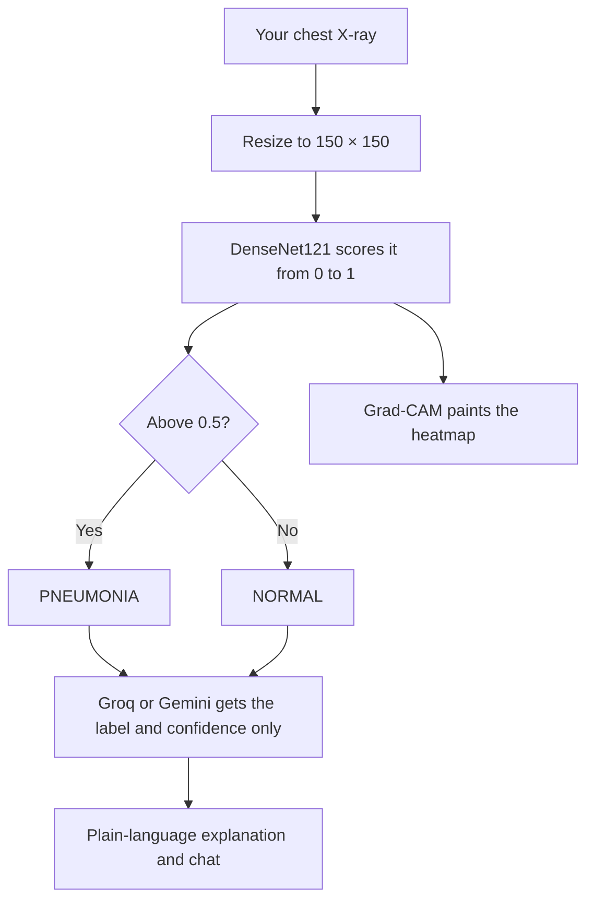
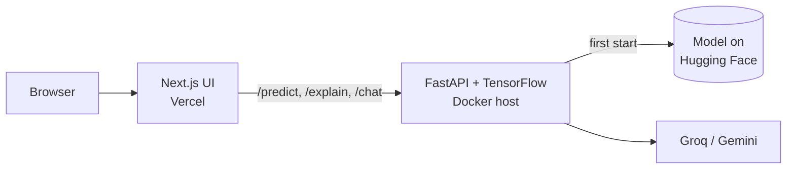

<!-- Automatically generated from README.md by .github/workflows/translate-readme.yml. Do not edit by hand. -->
<p align="center"><sub><a href="../../README.md">English</a> · <a href="README.ta.md">தமிழ்</a> · <a href="README.hi.md">हिन्दी</a> · <a href="README.te.md">తెలుగు</a> · <a href="README.ml.md">മലയാളം</a> · <a href="README.kn.md">ಕನ್ನಡ</a> · <a href="README.bn.md">বাংলা</a> · <a href="README.es.md">Español</a> · <a href="README.fr.md">Français</a> · <a href="README.de.md">Deutsch</a> · <b>Português</b> · <a href="README.ja.md">日本語</a> · <a href="README.zh-CN.md">简体中文</a> · <a href="README.ar.md">العربية</a></sub></p>

<p align="center">
  <a href="https://pneumonia-detector-machine-learning.vercel.app">
    
  </a>
</p>

<p align="center">
  <a href="https://pneumonia-detector-machine-learning.vercel.app"><b>Demo ao vivo</b></a>
  &nbsp;·&nbsp;
  <a href="#how-it-works">Como funciona</a>
  &nbsp;·&nbsp;
  <a href="#run-it-yourself">Execute você mesmo</a>
</p>

<p align="center">
  
  
  
  
  
</p>


PneumoScan é uma ferramenta de triagem por raio‑X de tórax que devolve mais que um rótulo. Para cada imagem, ela relata um veredicto com pontuação de confiança, um mapa de calor Grad‑CAM da região que influenciou a predição e uma explicação em linguagem natural que pode ser explorada por meio de um chat.

A demonstração ao vivo inclui raios‑X de exemplo que podem ser executados com um único clique, e aceita o envio de suas próprias imagens.

> **PneumoScan é uma demonstração de triagem, não uma ferramenta diagnóstica.** Um clínico qualificado deve revisar cada raio‑X. Qualquer pessoa que apresente falta de ar grave ou dor torácica deve buscar atendimento médico imediatamente.

<p align="center">
  
</p>

## Features

<p align="center">
  
</p>

* **Veredicto e confiança.** Cada raio‑X é classificado como NORMAL ou PNEUMONIA, juntamente com a confiança do modelo nesse resultado.
* **Evidência visual.** Um mapa de calor Grad‑CAM é exibido ao lado da imagem original, com um controle deslizante de comparação e uma lente de zoom para inspeção mais detalhada.
* **Explicação em linguagem natural.** Um modelo de linguagem (Groq, com Gemini como alternativa) explica o que o resultado significa e o que não significa. Ele é instruído a nunca diagnosticar ou recomendar tratamento.
* **Chat contextual.** Perguntas de acompanhamento são respondidas no contexto do resultado. Perguntas não relacionadas são recusadas educadamente.
* **Cartão de resultado compartilhável.** Qualquer resultado pode ser salvo como imagem PNG.
* **Degradação graciosa.** A predição ainda é exibida quando o mapa de calor ou o modelo de linguagem não estão disponíveis.

<a id="how-it-works"></a>

## How it works

O caminho de um raio‑X enviado através do sistema:



Apenas o rótulo previsto e sua confiança são enviados ao modelo de linguagem. A própria imagem nunca é compartilhada com ele.

A arquitetura do sistema implantado:



A API expõe quatro endpoints: `/health`, `/predict`, `/explain` e `/chat`. O notebook de treinamento está disponível em [`Notebook/`](../../Notebook).

<a id="run-it-yourself"></a>

## Run it yourself

```bash
git clone https://github.com/aristotile-dev/Pneumonia-Detector-Machine-Learning-Tensorflow.git
cd Pneumonia-Detector-Machine-Learning-Tensorflow
```

**Backend.** O modelo é baixado automaticamente na primeira inicialização. Defina `GROQ_API_KEY` ou `GEMINI_API_KEY` para habilitar a explicação e o chat (veja `backend/.env.example`).

```bash
cd backend
pip install -r requirements.txt
uvicorn main:app --reload
```

**Frontend**, em um segundo terminal:

```bash
cd frontend
cp .env.example .env.local
npm install
npm run dev
```

Então abra http://localhost:3000.

## Deploying

A API não pode ser executada como uma função Vercel: suas dependências totalizam cerca de 1,2 GB, acima do limite de 500 MB da Vercel. Ela requer um host Docker com pelo menos 2 GB de RAM. `backend/Dockerfile` escuta na variável `$PORT`.

| Backend variable | Required | Description |
| :--- | :---: | :--- |
| `GROQ_API_KEY` or `GEMINI_API_KEY` | One of the two | Enables the explanation and chat. Groq takes precedence when both are set. |
| `ALLOWED_ORIGINS` | Yes | The frontend origin. Separate several origins with commas. |
| `MODEL_URL`, `HF_TOKEN` | No | Load the model from a different location. |

Uma resposta `model_loaded: true` de `/health` confirma que o modelo está pronto.

Para o frontend no Vercel, defina o Root Directory como `frontend` e configure `NEXT_PUBLIC_API_URL` para a URL base da API sem barra final. O valor é incorporado no tempo de build, portanto faça redeploy após alterá‑lo.

## Technology

| Layer | Technology |
| :--- | :--- |
| Model | DenseNet121 with transfer learning, built with TensorFlow and Keras |
| Explainability | Grad-CAM heatmaps |
| Image processing | Pillow and NumPy |
| API | FastAPI served by Uvicorn |
| Interface | Next.js 15 (App Router), plain CSS and the Archivo typeface |
| Language model | Groq (`openai/gpt-oss-120b`), with Gemini (`gemini-3.5-flash-lite`) as a fallback |
| Model hosting | Hugging Face Hub |

## License

Released under the MIT License. See [LICENSE](../../LICENSE) for the full text.
