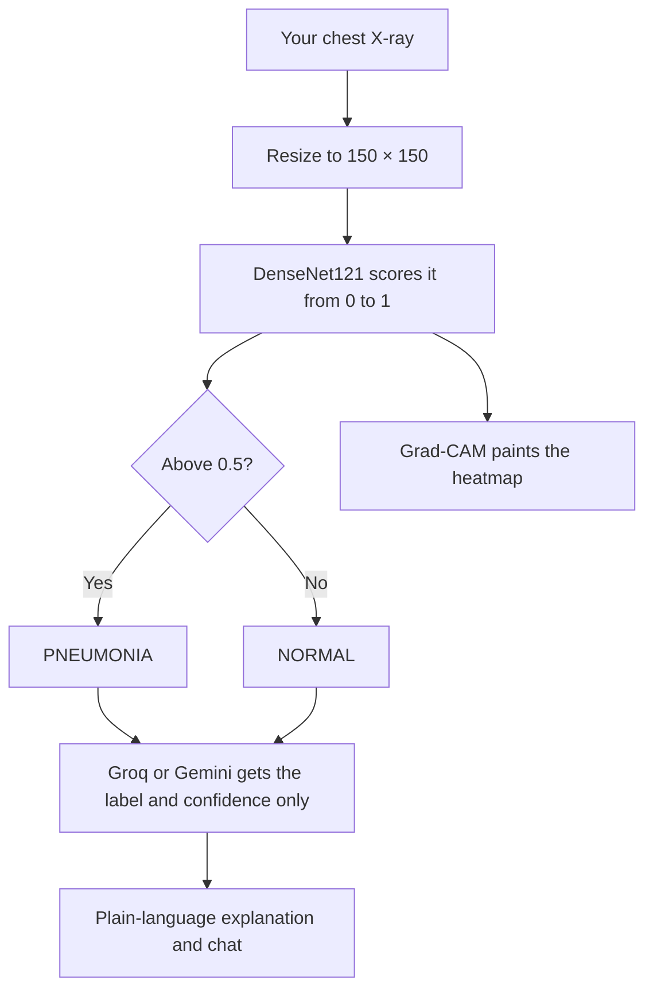
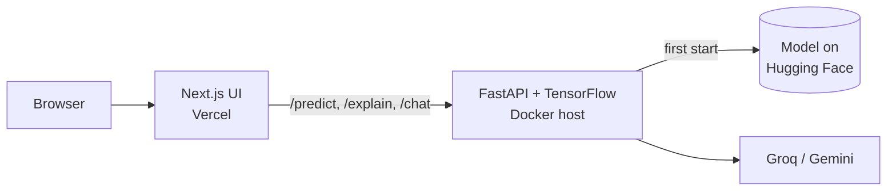

<!-- Automatically generated from README.md by .github/workflows/translate-readme.yml. Do not edit by hand. -->
<p align="center"><sub><a href="../../README.md">English</a> · <b>தமிழ்</b> · <a href="README.hi.md">हिन्दी</a> · <a href="README.te.md">తెలుగు</a> · <a href="README.ml.md">മലയാളം</a> · <a href="README.kn.md">ಕನ್ನಡ</a> · <a href="README.bn.md">বাংলা</a> · <a href="README.es.md">Español</a> · <a href="README.fr.md">Français</a> · <a href="README.de.md">Deutsch</a> · <a href="README.pt-BR.md">Português</a> · <a href="README.ja.md">日本語</a> · <a href="README.zh-CN.md">简体中文</a> · <a href="README.ar.md">العربية</a></sub></p>

<p align="center">
  <a href="https://pneumonia-detector-machine-learning.vercel.app">
    
  </a>
</p>

<p align="center">
  <a href="https://pneumonia-detector-machine-learning.vercel.app"><b>Live demo</b></a>
  &nbsp;·&nbsp;
  <a href="#how-it-works">How it works</a>
  &nbsp;·&nbsp;
  <a href="#run-it-yourself">Run it yourself</a>
</p>

<p align="center">
  
  
  
  
  
</p>


PneumoScan என்பது ஒரு மார்பு X‑ray திரையிடும் கருவி, இது ஒரு லேபிளை மட்டுமல்லாமல் கூடுதல் தகவல்களை வழங்குகிறது. ஒவ்வொரு படத்திற்கும் இது ஒரு தீர்மானம், நம்பிக்கை மதிப்பு, முன்னறிவிப்பை இயக்கிய பகுதியின் Grad‑CAM வெப்பவரைபடம், மற்றும் உரையாடல் மூலம் ஆராயக்கூடிய எளிய மொழி விளக்கத்தை வழங்குகிறது.

நேரடி டெமோவில் ஒரு கிளிக்கில் இயக்கக்கூடிய மாதிரி X‑ray கள் உள்ளன, மேலும் உங்கள் சொந்த படங்களை பதிவேற்றவும் முடியும்.

> **PneumoScan என்பது ஒரு திரையிடும் விளக்கமாகும், மருத்துவக் கண்டறிதல் கருவி அல்ல.** ஒவ்வொரு X‑ray‑யையும் தகுதியான மருத்துவ நிபுணர் மதிப்பாய்வு செய்ய வேண்டும். கடுமையான மூச்சுத்திணறல் அல்லது மார்பு வலி அனுபவிக்கும் யாரும் உடனடியாக மருத்துவ உதவியை நாட வேண்டும்.

<p align="center">
  
</p>

## Features

<p align="center">
  
</p>

* **Verdict and confidence.** ஒவ்வொரு X‑ray‑யும் NORMAL அல்லது PNEUMONIA ஆக வகைப்படுத்தப்படுகிறது, மேலும் மாதிரியின் நம்பிக்கை மதிப்பும் வழங்கப்படுகிறது.
* **Visual evidence.** Grad‑CAM வெப்பவரைபடம் அசல் படத்தின் பக்கத்தில் காட்டப்படுகிறது, ஒப்பீட்டு ஸ்லைடர் மற்றும் நெருக்கமாகப் பார்க்க ஜூம் லென்ஸ் உடன்.
* **Plain-language explanation.** ஒரு மொழி மாதிரி (Groq, Gemini fallback உடன்) முடிவின் பொருள் என்ன, என்ன அல்ல என்பதை விளக்குகிறது. இது எப்போதும் மருத்துவக் கண்டறிதல் அல்லது சிகிச்சை பரிந்துரைகளை வழங்காது.
* **Contextual chat.** முடிவின் சூழலில் பின்வரும் கேள்விகளுக்கு பதில் அளிக்கிறது. தொடர்பற்ற கேள்விகள் மரியாதையுடன் நிராகரிக்கப்படும்.
* **Shareable result card.** எந்த முடிவையும் PNG படமாக சேமிக்கலாம்.
* **Graceful degradation.** வெப்பவரைபடம் அல்லது மொழி மாதிரி கிடைக்காதபோதும் முன்னறிவிப்பு காட்டப்படும்.

<a id="how-it-works"></a>

## How it works

ஒரு பதிவேற்றப்பட்ட X‑ray அமைப்பில் கடந்து செல்லும் பாதை:



முன்னறிவிப்பு லேபிள் மற்றும் அதன் நம்பிக்கை மட்டுமே மொழி மாதிரிக்கு அனுப்பப்படுகிறது. படம் தானாகவே எப்போதும் பகிரப்படாது.

விநியோகிக்கப்பட்ட அமைப்பின் கட்டமைப்பு:



API நான்கு இறுதிநிலைகளை வெளிப்படுத்துகிறது: `/health`, `/predict`, `/explain` மற்றும் `/chat`. பயிற்சி நோட்புக் [`Notebook/`](../../Notebook) இல் கிடைக்கிறது.

<a id="run-it-yourself"></a>

## Run it yourself

```bash
git clone https://github.com/aristotile-dev/Pneumonia-Detector-Machine-Learning-Tensorflow.git
cd Pneumonia-Detector-Machine-Learning-Tensorflow
```

**Backend.** முதல் தொடக்கத்தில் மாதிரி தானாகவே பதிவிறக்கம் செய்யப்படும். விளக்கம் மற்றும் உரையாடலை செயல்படுத்த `GROQ_API_KEY` அல்லது `GEMINI_API_KEY` அமைக்கவும் (`backend/.env.example` ஐ பார்க்கவும்).

```bash
cd backend
pip install -r requirements.txt
uvicorn main:app --reload
```

**Frontend**, இரண்டாவது டெர்மினலில்:

```bash
cd frontend
cp .env.example .env.local
npm install
npm run dev
```

பின்னர் http://localhost:3000 ஐ திறக்கவும்.

## Deploying

API‑ஐ Vercel செயல்பாடாக இயக்க முடியாது: அதன் சார்புகள் மொத்தம் சுமார் 1.2 GB, Vercel‑இன் 500 MB வரம்பை மீறுகிறது. குறைந்தது 2 GB RAM கொண்ட Docker ஹோஸ்ட் தேவை. `backend/Dockerfile` `$PORT` இல் கேட்கிறது.

| Backend variable | Required | Description |
| :--- | :---: | :--- |
| `GROQ_API_KEY` or `GEMINI_API_KEY` | One of the two | விளக்கம் மற்றும் உரையாடலை செயல்படுத்தும். இரண்டும் அமைக்கப்பட்டால் Groq முன்னுரிமை பெறும். |
| `ALLOWED_ORIGINS` | Yes | Frontend மூலவளம். பல மூலவளங்களை கமா மூலம் பிரிக்கவும். |
| `MODEL_URL`, `HF_TOKEN` | No | மாதிரியை வேறு இடத்திலிருந்து ஏற்றவும். |

`/health` இலிருந்து `model_loaded: true` என்ற பதில் மாதிரி தயாராக இருப்பதை உறுதிப்படுத்தும்.

Vercel‑இல் frontend‑க்கு, Root Directory ஐ `frontend` ஆக அமைத்து, `NEXT_PUBLIC_API_URL` ஐ இறுதியில் ஸ்லாஷ் இல்லாமல் API‑யின் அடிப்படை URL ஆக அமைக்கவும். இந்த மதிப்பு கட்டுமான நேரத்தில் சேர்க்கப்படும், ஆகையால் மாற்றிய பின் மீண்டும் வெளியிடவும்.

## Technology

| Layer | Technology |
| :--- | :--- |
| Model | DenseNet121 with transfer learning, built with TensorFlow and Keras |
| Explainability | Grad-CAM heatmaps |
| Image processing | Pillow and NumPy |
| API | FastAPI served by Uvicorn |
| Interface | Next.js 15 (App Router), plain CSS and the Archivo typeface |
| Language model | Groq (`openai/gpt-oss-120b`), with Gemini (`gemini-3.5-flash-lite`) as a fallback |
| Model hosting | Hugging Face Hub |

## License

Released under the MIT License. See [LICENSE](../../LICENSE) for the full text.
