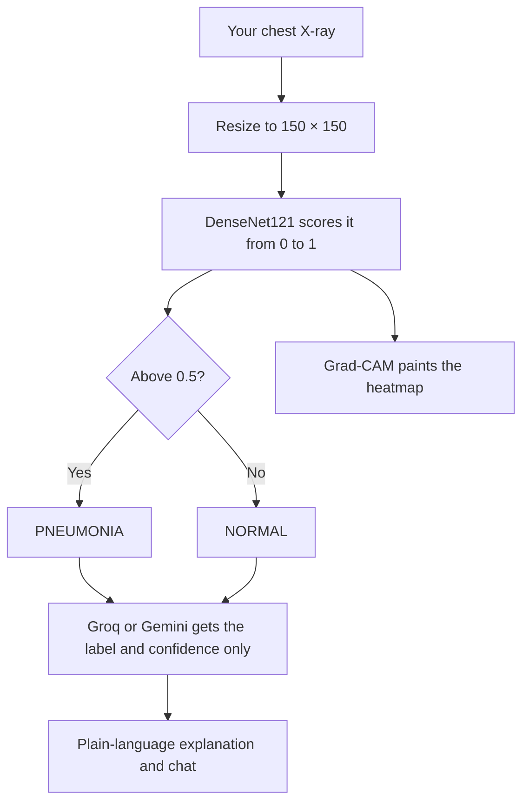
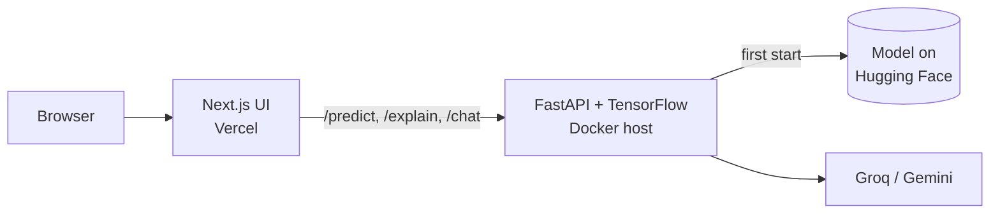

<!-- Automatically generated from README.md by .github/workflows/translate-readme.yml. Do not edit by hand. -->
<p align="center"><sub><a href="../../README.md">English</a> · <a href="README.ta.md">தமிழ்</a> · <a href="README.hi.md">हिन्दी</a> · <b>తెలుగు</b> · <a href="README.ml.md">മലയാളം</a> · <a href="README.kn.md">ಕನ್ನಡ</a> · <a href="README.bn.md">বাংলা</a> · <a href="README.es.md">Español</a> · <a href="README.fr.md">Français</a> · <a href="README.de.md">Deutsch</a> · <a href="README.pt-BR.md">Português</a> · <a href="README.ja.md">日本語</a> · <a href="README.zh-CN.md">简体中文</a> · <a href="README.ar.md">العربية</a></sub></p>

<p align="center">
  <a href="https://pneumonia-detector-machine-learning.vercel.app">
    
  </a>
</p>

<p align="center">
  <a href="https://pneumonia-detector-machine-learning.vercel.app"><b>Live demo</b></a>
  &nbsp;·&nbsp;
  <a href="#how-it-works">How it works</a>
  &nbsp;·&nbsp;
  <a href="#run-it-yourself">Run it yourself</a>
</p>

<p align="center">
  
  
  
  
  
</p>


PneumoScan అనేది ఛెస్ట్ X‑ray స్క్రీనింగ్ సాధనం, ఇది లేబుల్‌కి మించి ఫలితాలను ఇస్తుంది. ప్రతి చిత్రానికి ఇది ఒక తీర్పు, నమ్మక స్కోరు, అంచనాను నడిపిన ప్రాంతాన్ని చూపే Grad‑CAM హీట్‌మ్యాప్, అలాగే చాట్ ద్వారా అన్వేషించగల సులభ‑భాషా వివరణను అందిస్తుంది.

లైవ్ డెమోలో ఒక క్లిక్‌తో నడిపించగల నమూనా X‑ray లు ఉన్నాయి, అలాగే మీరు మీ స్వంత చిత్రాలను అప్లోడ్ చేయవచ్చు.

> **PneumoScan ఒక స్క్రీనింగ్ ప్రదర్శన, నిర్ధారణ సాధనం కాదు.** ప్రతి X‑ray ను అర్హత కలిగిన వైద్యుడు సమీక్షించాలి. తీవ్రమైన శ్వాసకష్టము లేదా ఛెస్ట్ నొప్పి అనుభవిస్తున్న ఎవరికైనా తక్షణమే వైద్య సహాయం పొందాలి.

<p align="center">
  
</p>

## Features

<p align="center">
  
</p>

* **Verdict and confidence.** Each X-ray is classified as NORMAL or PNEUMONIA, together with the model's confidence in that result.
* **Visual evidence.** A Grad-CAM heatmap is displayed beside the original image, with a comparison slider and a zoom lens for closer inspection.
* **Plain-language explanation.** A language model (Groq, with Gemini as a fallback) explains what the result does and does not mean. It is instructed never to diagnose or recommend treatment.
* **Contextual chat.** Follow-up questions are answered in the context of the result. Unrelated questions are politely declined.
* **Shareable result card.** Any result can be saved as a PNG image.
* **Graceful degradation.** The prediction is still displayed when the heatmap or the language model is unavailable.

<a id="how-it-works"></a>

## How it works

The path of an uploaded X-ray through the system:



Only the predicted label and its confidence are sent to the language model. The image itself is never shared with it.

The architecture of the deployed system:



The API exposes four endpoints: `/health`, `/predict`, `/explain` and `/chat`. The training notebook is available in [`Notebook/`](../../Notebook).

<a id="run-it-yourself"></a>

## Run it yourself

```bash
git clone https://github.com/aristotile-dev/Pneumonia-Detector-Machine-Learning-Tensorflow.git
cd Pneumonia-Detector-Machine-Learning-Tensorflow
```

**Backend.** The model is downloaded automatically on first start. Set `GROQ_API_KEY` or `GEMINI_API_KEY` to enable the explanation and chat (see `backend/.env.example`).

```bash
cd backend
pip install -r requirements.txt
uvicorn main:app --reload
```

**Frontend**, in a second terminal:

```bash
cd frontend
cp .env.example .env.local
npm install
npm run dev
```

Then open http://localhost:3000.

## Deploying

The API cannot run as a Vercel function: its dependencies total about 1.2 GB, above Vercel's 500 MB limit. It requires a Docker host with at least 2 GB of RAM. `backend/Dockerfile` listens on `$PORT`.

| Backend variable | Required | Description |
| :--- | :---: | :--- |
| `GROQ_API_KEY` or `GEMINI_API_KEY` | One of the two | Enables the explanation and chat. Groq takes precedence when both are set. |
| `ALLOWED_ORIGINS` | Yes | The frontend origin. Separate several origins with commas. |
| `MODEL_URL`, `HF_TOKEN` | No | Load the model from a different location. |

A response of `model_loaded: true` from `/health` confirms that the model is ready.

For the frontend on Vercel, set the Root Directory to `frontend` and set `NEXT_PUBLIC_API_URL` to the API's base URL without a trailing slash. The value is embedded at build time, so redeploy after changing it.

## Technology

| Layer | Technology |
| :--- | :--- |
| Model | DenseNet121 with transfer learning, built with TensorFlow and Keras |
| Explainability | Grad-CAM heatmaps |
| Image processing | Pillow and NumPy |
| API | FastAPI served by Uvicorn |
| Interface | Next.js 15 (App Router), plain CSS and the Archivo typeface |
| Language model | Groq (`openai/gpt-oss-120b`), with Gemini (`gemini-3.5-flash-lite`) as a fallback |
| Model hosting | Hugging Face Hub |

## License

Released under the MIT License. See [LICENSE](../../LICENSE) for the full text.
